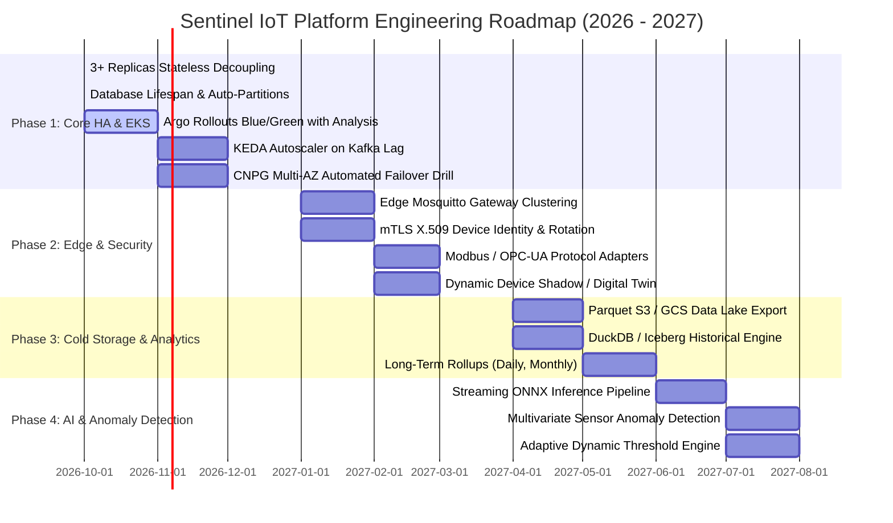

# RFC-001: Sentinel IoT Platform Production Readiness, Lifespan Extension & Scaling Roadmap

- **RFC Number:** RFC-001
- **Title:** Production Readiness, Database Lifespan Extension & EKS Scaling Roadmap
- **Status:** **Accepted / In Implementation**
- **Author:** Sentinel IoT Architecture Team
- **Created:** 2026-10-11
- **Target Release:** v1.2.0 - v2.0.0 (Q4 2026 - Q3 2027)

---

## 1. Executive Summary

This RFC defines the production hardening architecture and technical roadmap for the Sentinel IoT Platform. It formalizes:
1. **The Database Lifespan Architecture:** Proactive monthly range partitioning combined with automated background provisioning, ensuring zero maintenance and high query pruning performance on AWS RDS / Aurora and CloudNativePG.
2. **Stateless Backend Scaling on Kubernetes/EKS:** Full decoupling of state across 3+ replicas using Redis Pub/Sub for realtime WebSocket fan-out, Redis CAS for distributed rate limiting, and MQTT 5 Shared Subscriptions for fair ingestion load balancing.
3. **A 4-Phase Technical Roadmap:** Spanning Q4 2026 through Q3 2027, covering Blue/Green Rollouts, Edge mTLS Gateways, Cold Storage Data Lakehouse integration, and AI-driven Anomaly Detection.

---

## 2. Motivation & Business Drivers

Sentinel IoT Platform manages industrial telemetry across multiple enterprise tenants. As device counts grow from hundreds to tens of thousands, the platform must guarantee:
- **Availability SLA:** 99.95% uptime (monthly error budget: 21.9 minutes).
- **Ingestion Latency:** Sub-50ms p95 from device publish to Kafka.
- **Query Performance:** Sub-10ms p95 on live dashboards and sub-100ms on 7-day hourly analytics.
- **Zero-Downtime Deployments:** Continuous deployment on EKS with instant rollback and automated SLO health gates.
- **Tenant Isolation:** Cryptographic and logical data isolation across all shared infrastructure components.

---

## 3. Architecture Specification

### 3.1 High-Level Component Topology

```mermaid
flowchart TB
    subgraph Ingestion Tier [Industrial Ingestion Tier]
        Sensors[Sensors & Edge Gateways]
        Mosquitto[Mosquitto 2.x Broker Cluster]
    end

    subgraph EKS [AWS EKS Cluster - Backend Tier]
        Pod1[Backend Replica 1<br/>(Stateless)]
        Pod2[Backend Replica 2<br/>(Stateless)]
        Pod3[Backend Replica 3<br/>(Stateless)]
    end

    subgraph Storage [Distributed Data Tier]
        Kafka[Kafka Cluster<br/>telemetry.raw (3+ Partitions)]
        Redis[(Redis Cluster)<br/>Cache + Pub/Sub + CAS]
        Postgres[(PostgreSQL 16 Multi-AZ)<br/>Monthly Partitions + RLS]
    end

    subgraph Clients [Clients & Ops]
        Web[Browser WebSockets]
        Prometheus[Prometheus / Grafana]
    end

    Sensors -->|MQTT QoS 1| Mosquitto
    Mosquitto -->|"$share/sentinel/tenants/+/telemetry"<br/>Load Balanced| Pod1 & Pod2 & Pod3
    Pod1 & Pod2 & Pod3 -->|Publish| Kafka
    Kafka -->|Batch Ingest| Pod1 & Pod2 & Pod3
    Pod1 & Pod2 & Pod3 -->|Batch Insert| Postgres
    Pod1 & Pod2 & Pod3 <-->|Fan-out ws:telemetry & CAS Rate Limits| Redis
    Redis -->|Pub/Sub Fan-out| Pod1 & Pod2 & Pod3
    Pod1 & Pod2 & Pod3 -->|Local WS Sessions| Web
    Pod1 & Pod2 & Pod3 -.->|Micrometer Metrics| Prometheus
```

---

### 3.2 Implemented Architectural Pillars

#### Pillar A: Production Database Lifespan
- **Range Partitioning Runway:** Native declarative partitioning on `timestamp` with static pre-provisioned tables up to `2028-12` (Flyway `V14`).
- **Dynamic Auto-Provisioning:** `TelemetryRetentionService.ensureUpcomingPartitions(6)` runs on the 1st of every month at 03:00 UTC, pre-creating partitions 6 months in advance with a Redis distributed lock (`lock:telemetry:partition-provision`).
- **Purge & Detach Lifecycle:** Unused child tables older than 30 days are detached and dropped in $O(1)$ constant time without full table scans.

#### Pillar B: Stateless Horizontal Scaling (3+ Replicas on EKS)
- **MQTT Gateway:** Each pod receives a unique client ID via the Kubernetes Downward API (`${clientId}-${INSTANCE_ID}-inbound`). Topics are subscribed using MQTT 5 Shared Subscriptions (`$share/sentinel/...`) to distribute load round-robin across pods.
- **Realtime WebSocket Fan-Out:** Backend instances broadcast telemetry events to Redis channel `ws:telemetry` (`<orgId>|<payload>`). Every replica receives the broadcast and fans it out to its connected browser sessions.
- **Distributed CAS Rate Limiter:** Lettuce Redis CAS token bucket enforces global per-IP limits (10 req/min for auth, 100 req/min for general API) across all pods behind AWS ALB.
- **Replay Queue & Alert Deduplication Resilience:**
  - Redis replay queue exposes drop metric `sentinel.replay.queue.overflow` and Prometheus alert `SentinelReplayQueueTelemetryDropped`.
  - Notification deduplicator features in-memory fallback cache to prevent alert storms during Redis outages.

---

## 4. Phased Engineering Roadmap



---

### Detailed Phase Specifications

### Phase 1: Production Hardening & EKS Blue/Green Deployment (Q4 2026)
- **Objective:** Complete automated CD pipeline, chaos testing, and autoscaling.
- **Deliverables:**
  1. **Argo Rollouts Blue/Green Pipeline:** Pre-promotion analysis runs Prometheus queries against preview service (`sentinel-backend-health` template checking HTTP 5xx rate < 0.1% and latency p95 < 200ms).
  2. **KEDA Autoscaling:** Scale backend pods between 3 and 10 based on Kafka consumer group lag (`sentinel-telemetry-ingest`) and Redis replay queue depth.
  3. **CloudNativePG HA Failover Verification:** Automated chaos drill killing primary database pod and asserting failover within 30 seconds with 0 data loss.
  4. **Acceptance Criteria:** Zero downtime deployments verified under continuous load with 0 dropped telemetry messages.

### Phase 2: Edge Ingestion & Industrial Protocols (Q1 2027)
- **Objective:** Extend ingestion capabilities to factory edge networks with enterprise-grade identity.
- **Deliverables:**
  1. **Edge Broker Clustering:** Deploy localized Mosquitto edge gateways with Store-and-Forward capability for factories with intermittent WAN connectivity.
  2. **mTLS Device Identity & Auto-Enrollment:** X.509 certificate authentication for devices, integrated with HashiCorp Vault / AWS Private CA for automated certificate renewal.
  3. **Industrial Protocol Bridges:** Microservices to translate OPC-UA and Modbus TCP payloads into standard Sentinel v2 telemetry JSON.
  4. **Device Twin / Shadow:** Stateful desired vs. reported state synchronization in Redis.
  5. **Acceptance Criteria:** Support for 25,000 active concurrent MQTT connections with mTLS.

### Phase 3: Cold Storage & Lakehouse Historical Analytics (Q2 2027)
- **Objective:** Cost-effective multi-year analytics beyond the 30-day PostgreSQL retention window.
- **Deliverables:**
  1. **Automated S3/GCS Parquet Archival:** When monthly partitions are detached during the retention job, stream raw rows into columnar Apache Parquet files partitioned by `org_id/year/month`.
  2. **Lakehouse Analytics Engine:** Integrate DuckDB or Apache Iceberg for sub-second aggregations across multi-year historical datasets directly from object storage.
  3. **Tiered Rollup Pipeline:** Pre-compute daily and monthly aggregate rollups alongside existing hourly buckets.
  4. **Acceptance Criteria:** Cost reduction of >70% on database storage while maintaining interactive reporting on 2-year trends.

### Phase 4: Realtime AI & Anomaly Detection (Q3 2027)
- **Objective:** Move from reactive static threshold alerts to predictive anomaly detection.
- **Deliverables:**
  1. **Streaming ML Inference:** Deploy high-throughput Python/ONNX Runtime worker consuming from Kafka in parallel with the database consumer.
  2. **Multivariate Anomaly Models:** Isolation Forest and Autoencoder models to detect anomalous sensor correlations (e.g. rising temperature with falling humidity).
  3. **Adaptive Thresholds:** Automatically adjust alarm trigger bands based on ambient seasonal patterns and machine operating modes.
  4. **Acceptance Criteria:** Precision > 95% on thermal runaway alerts with 0.01% false positive rate.

---

## 5. Security & Multi-Tenancy Architecture

| Layer | Implementation | Verification |
|---|---|---|
| **Identity & Authentication** | JWT with 15-minute access tokens + rotating DB refresh tokens + Redis JTI revocation blocklist | JMH benchmark gate (<1ms) & automated security regression test suite |
| **Data Isolation** | PostgreSQL Row-Level Security (RLS) with tenant context aspect | `TenantRlsAspectTest` + Multi-tenant isolation tests |
| **Network Boundary** | Ingress TLS termination, internal mTLS via Kubernetes NetworkPolicies | NetworkPolicy templates in Helm chart |
| **API Abuse Prevention** | Bucket4j Distributed Redis CAS Rate Limiter with Trusted Proxy support | `RateLimitFilterTest` & in-memory fallback verification |
| **Audit Logging** | Immutable `audit_logs` table with username, action, resource, IP, and timestamp | Automated 90-day retention pruning job |

---

## 6. Success Metrics & SLO Targets

| Metric | Target SLO | Monitoring Indicator |
|---|---|---|
| **API Availability** | $\ge 99.95\%$ | `http_server_requests_seconds_count{status!~"5.."}` / total |
| **MQTT Ingest Latency** | P95 $\le 50\text{ ms}$ | `sentinel.mqtt.processing_time_seconds` |
| **Database Query Latency** | P95 $\le 10\text{ ms}$ | `sentinel.telemetry.query.p95` |
| **Replay Queue Dropped** | $0\text{ msgs/min}$ | `sentinel.replay.queue.overflow` |
| **Kafka Ingest Lag** | $\le 100\text{ records}$ | `kafka_consumergroup_lag{group="sentinel-telemetry-ingest"}` |

---

## 7. Architecture Decision Records Reference

This RFC builds upon the following ADRs:
- [ADR-0001: Telemetry Database Lifespan: PostgreSQL Native Range Partitioning vs. TimescaleDB](file:///Users/thitipongroo/workspace/github/sentinel-iot-platform/docs/adr/0001-database-lifespan-native-partitioning-vs-timescaledb.md)
- [ADR-0002: Stateless Multi-Replica Scaling on EKS via Redis Pub/Sub, Distributed Rate Limiting & MQTT Shared Subscriptions](file:///Users/thitipongroo/workspace/github/sentinel-iot-platform/docs/adr/0002-stateless-backend-redis-pubsub-and-mqtt-shared-subscriptions.md)
- [ADR-0003: Distributed Resilience: Replay Queue Drop Observability and Cache-Fallbacked Alert Deduplication](file:///Users/thitipongroo/workspace/github/sentinel-iot-platform/docs/adr/0003-distributed-resilience-replay-queue-and-alert-deduplication.md)
