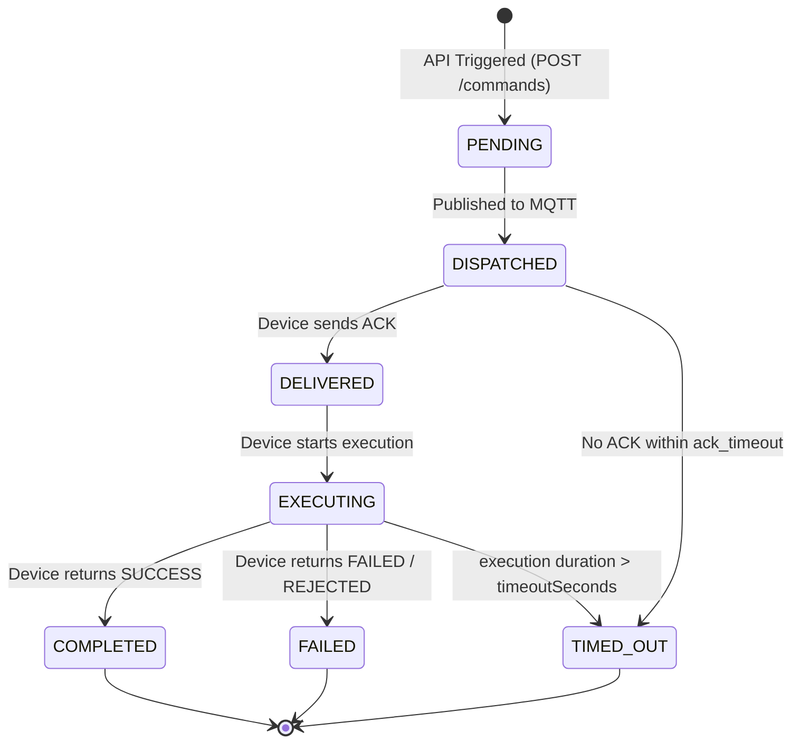
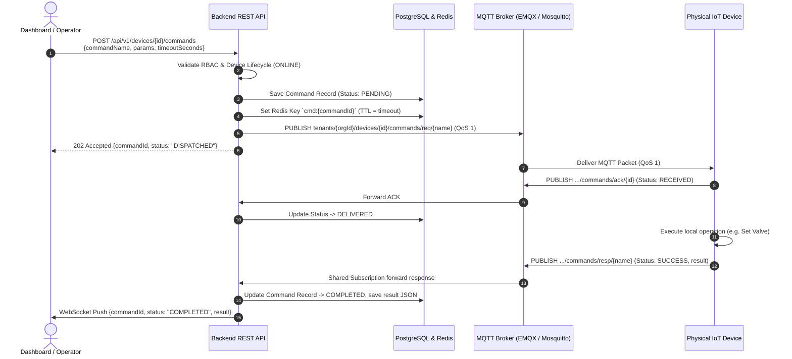

# Command & Control (C2 / RPC) Protocol Architecture

- **Status:** Approved Architecture Specification
- **Version:** 1.0.0
- **Scope:** Cloud-to-Device (C2D) and Device-to-Cloud (D2C) RPC Messaging
- **Target Audience:** Backend Engineers, Embedded Firmware Engineers, Solution Architects

---

## 1. Overview & Objective

The **Command & Control (C2 / RPC)** protocol enables reliable, secure, asynchronous bidirectional Remote Procedure Calls between the Sentinel IoT Cloud Platform and physical edge devices/gateways.

Common use cases include:
- **Actuator Control:** Turning valves, setting motor speed, tripping circuit breakers.
- **Configuration Tuning:** Dynamically adjusting sensor sampling frequency, calibration offsets.
- **Device Maintenance:** Remote restart, diagnostic snapshot request, log upload triggering.
- **Over-The-Air (OTA) Actions:** Triggering firmware download, pre-installation verification, rollback.

---

## 2. Communication Topology & Topic Hierarchy

Communication operates over MQTT with distinct request and response topic namespaces per tenant and device to enforce strict multi-tenant isolation.

```text
MQTT Topic Schema:
─────────────────────────────────────────────────────────────────────────────
Command Request:   tenants/{orgId}/devices/{deviceId}/commands/req/{commandName}
Command Response:  tenants/{orgId}/devices/{deviceId}/commands/resp/{commandName}
Command ACK:       tenants/{orgId}/devices/{deviceId}/commands/ack/{commandId}
─────────────────────────────────────────────────────────────────────────────
```

### Topic Access Rules
- **Device Subscriptions:** Device subscribes only to `tenants/{orgId}/devices/{deviceId}/commands/req/+`.
- **Device Publications:** Device publishes to `tenants/{orgId}/devices/{deviceId}/commands/resp/+` and `.../ack/+`.
- **Cloud Gateway:** Subscribes via MQTT 5 Shared Subscription `$share/sentinel-c2/tenants/+/devices/+/commands/resp/+` to balance response processing across backend replicas.

---

## 3. Message Envelope Specification

All payloads use UTF-8 JSON. Every command request and response contains a standard envelope.

### 3.1 Command Request Envelope

Published by the Cloud Backend to `tenants/{orgId}/devices/{deviceId}/commands/req/{commandName}`:

```json
{
  "commandId": "cmd_7c9e6679-7425-40de-944b-e07fc1f90ae7",
  "correlationId": "req_f47ac10b-58cc-4372-a567-0e02b2c3d479",
  "commandName": "SET_SAMPLE_RATE",
  "version": 1,
  "issuedAt": "2026-10-11T15:30:00.000Z",
  "expiresAt": "2026-10-11T15:30:30.000Z",
  "timeoutSeconds": 30,
  "qos": 1,
  "params": {
    "sensorType": "TEMPERATURE",
    "intervalMs": 1000,
    "burstMode": false
  },
  "signature": "e3b0c44298fc1c149afbf4c8996fb92427ae41e4649b934ca495991b7852b855"
}
```

| Field | Type | Required | Description |
|---|---|---|---|
| `commandId` | String (UUID) | Yes | Unique identifier for tracking and auditing this specific command execution. |
| `correlationId` | String (UUID) | Yes | Correlation ID propagated from the triggering REST/WebSocket client call. |
| `commandName` | String | Yes | Name of the RPC method (e.g., `REBOOT`, `SET_VALVE`, `UPGRADE_FIRMWARE`). |
| `version` | Integer | Yes | Schema version of the command payload (starts at 1). |
| `issuedAt` | ISO-8601 String | Yes | UTC timestamp when command was generated by cloud backend. |
| `expiresAt` | ISO-8601 String | Yes | UTC timestamp after which device must drop the command without executing. |
| `timeoutSeconds`| Integer | Yes | Maximum time cloud will wait for completion before marking `TIMED_OUT`. |
| `params` | Object | Yes | Arbitrary parameters payload mapped to the specific `commandName`. |
| `signature` | String (Hex) | Optional | HMAC-SHA256 signature for tamper-proof validation on sensitive commands. |

---

### 3.2 Device Acknowledgement (ACK)

Published by Device to `tenants/{orgId}/devices/{deviceId}/commands/ack/{commandId}` upon successful message reception (prior to long execution):

```json
{
  "commandId": "cmd_7c9e6679-7425-40de-944b-e07fc1f90ae7",
  "status": "RECEIVED",
  "receivedAt": "2026-10-11T15:30:00.412Z",
  "estimatedExecutionMs": 2500
}
```

---

### 3.3 Command Response Envelope

Published by Device to `tenants/{orgId}/devices/{deviceId}/commands/resp/{commandName}` upon completion:

```json
{
  "commandId": "cmd_7c9e6679-7425-40de-944b-e07fc1f90ae7",
  "correlationId": "req_f47ac10b-58cc-4372-a567-0e02b2c3d479",
  "commandName": "SET_SAMPLE_RATE",
  "status": "SUCCESS",
  "executedAt": "2026-10-11T15:30:02.890Z",
  "durationMs": 2478,
  "result": {
    "effectiveIntervalMs": 1000,
    "status": "APPLIED",
    "previousIntervalMs": 5000
  },
  "error": null
}
```

#### In case of failure:
```json
{
  "commandId": "cmd_7c9e6679-7425-40de-944b-e07fc1f90ae7",
  "correlationId": "req_f47ac10b-58cc-4372-a567-0e02b2c3d479",
  "commandName": "SET_SAMPLE_RATE",
  "status": "FAILED",
  "executedAt": "2026-10-11T15:30:01.120Z",
  "durationMs": 708,
  "result": null,
  "error": {
    "code": "INVALID_PARAMETER",
    "message": "intervalMs must be between 500 and 60000"
  }
}
```

---

## 4. Command Execution Lifecycle & State Machine



### State Definitions
1. **`PENDING`:** Command persisted in PostgreSQL `device_commands` table and tracked in Redis.
2. **`DISPATCHED`:** Command delivered to MQTT broker via `MqttPahoMessageHandler`.
3. **`DELIVERED`:** Device acknowledged receipt over `.../commands/ack/{commandId}`.
4. **`EXECUTING`:** Long-running task in progress on device.
5. **`COMPLETED`:** Device returned final successful response payload.
6. **`FAILED`:** Device returned error code, hardware rejection, or invalid parameters.
7. **`TIMED_OUT`:** Cloud deadline expired without receiving completion response.

---

## 5. End-to-End Sequence Diagram



---

## 6. Security & Integrity Architecture

1. **Role-Based Authorization (RBAC):**
   - Read-only actions (diagnostics snapshot): `ROLE_OPERATOR`, `ROLE_ADMIN`.
   - Write/Control actions (set valve, adjust threshold): `ROLE_OPERATOR`, `ROLE_ADMIN`.
   - Destructive actions (reboot, wipe config, firmware upgrade): `ROLE_ADMIN` only.
2. **Cryptographic Payload Signing:**
   - For mission-critical commands, cloud computes `HMAC-SHA256(deviceId + commandId + params, devicePreSharedKey)`.
   - Device verifies signature locally before executing. Prevents unauthorized commands even if broker is breached.
3. **Rate Limiting & Command Flooding Protection:**
   - Ingress rate limiting on API: Max 5 active pending commands per device.
   - Rejects duplicate rapid triggers with `429 Too Many Requests`.
4. **Audit Trail:**
   - Every issued command records `issued_by_username`, client IP, correlation ID, and execution duration in `audit_logs`.

---

## 7. Tradeoff Analysis & Technology Comparison

| Dimension | MQTT Asynchronous RPC (Chosen) | Direct Device HTTP / REST | CoAP (UDP-based) | gRPC over HTTP/2 |
|---|---|---|---|---|
| **NAT / Firewall Traversal** | **Seamless**. Reuses persistent outbound TLS connection. | **Fails**. Requires public IP, port forwarding, or reverse VPN tunnel. | **Challenging**. Stateful firewalls often block or drop UDP states. | **Fails**. Inbound connections to device blocked by carrier NAT. |
| **Connection Overhead** | **Zero extra**. Multiplexed over existing telemetry TCP session. | High (New TCP + TLS handshake per command). | Low (UDP datagram). | High (HTTP/2 framing + heavy gRPC state). |
| **Delivery Guarantee** | **QoS 1 (At least once)** + Broker offline buffering. | None. Fails immediately if device momentarily disconnects. | Confirmable (CON) retry logic. | Application layer retry needed. |
| **Hardware Footprint** | **Minimal**. Runs on microcontrollers (ESP32, STM32, Cortex-M). | Medium. Requires embedded HTTP web server stack. | Very light. Ideal for ultra-low power. | **Too Heavy**. Requires HTTP/2 + Protobuf + large RAM footprint. |
| **Call Semantics** | **Asynchronous (202 Accepted)** + Correlated completion push. | Synchronous Request / Response (Blocks caller). | Asynchronous or Piggybacked Response. | Synchronous / Streaming RPC. |
| **Cloud Scalability** | **High**. Decoupled via shared subscriptions across backend pods. | Low. Cloud threads blocked waiting for high-latency device socket. | Medium. Requires UDP ingress proxy. | High for server-to-server; poor for cellular edge. |

### Decision Rationale:
- **Direct HTTP/REST** was rejected because industrial field devices are deployed across 4G LTE/5G cellular private networks where carrier-grade NAT (CGNAT) prevents direct inbound connections. Exposing an HTTP server on edge hardware creates a massive security attack surface.
- **gRPC** was rejected due to excessive RAM/ROM resource demands on resource-constrained embedded microcontrollers.
- **CoAP** was rejected because industrial firewalls frequently throttle or drop arbitrary UDP traffic, and it would require maintaining a separate protocol gateway stack.
- **MQTT Asynchronous RPC** was selected because it multiplexes over the existing, verified TLS connection already maintained for telemetry, gracefully handles transient disconnections via broker queueing, and scales horizontally across stateless backend replicas.

**Tradeoff Accepted:** Cloud REST API callers cannot block synchronously on a single HTTP socket. The client receives `202 Accepted` and must track completion asynchronously via WebSocket or correlation ID polling.
