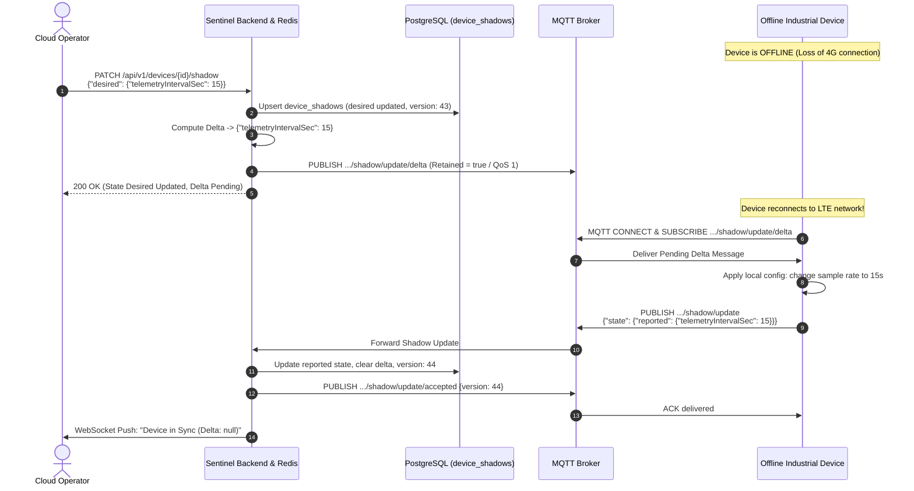

# Device Twin / Shadow Architecture & State Synchronization

- **Status:** Approved Architecture Specification
- **Version:** 1.0.0
- **Scope:** Device State Abstraction, Desired vs. Reported Synchronization & Delta Resolution
- **Target Audience:** Backend Engineers, Embedded Firmware Engineers, Frontend Engineers

---

## 1. Overview & Business Value

A **Device Twin (or Device Shadow)** is a JSON document maintained by the cloud platform that stores the current state information (properties, configurations, and metadata) of a physical device.

### Why Device Twin is Essential:
1. **Decoupled Asynchronous State:** Applications can read a device's current state instantly from the cloud without querying the physical hardware over intermittent cellular/satellite links.
2. **Offline Configuration Buffering:** When a device is offline, operators can modify its `desired` state. As soon as the device reconnects, the cloud computes the `delta` and pushes the pending configuration changes automatically.
3. **State Reconciliation & Audit:** Provides a single source of truth for comparing what a machine *should* be doing (`desired`) vs. what it is *actually* doing (`reported`).

---

## 2. Shadow Document Schema Specification

The Device Shadow document follows the standard industrial three-section model (`desired`, `reported`, `delta`) with per-property metadata and optimistic concurrency versioning.

```json
{
  "state": {
    "desired": {
      "telemetryIntervalSec": 15,
      "tempThresholdAlert": 75.0,
      "valveStatus": "CLOSED",
      "firmwareTarget": "v2.1.4"
    },
    "reported": {
      "telemetryIntervalSec": 60,
      "tempThresholdAlert": 80.0,
      "valveStatus": "CLOSED",
      "firmwareVersion": "v2.0.1",
      "batteryLevel": 94.2
    },
    "delta": {
      "telemetryIntervalSec": 15,
      "tempThresholdAlert": 75.0,
      "firmwareTarget": "v2.1.4"
    }
  },
  "metadata": {
    "desired": {
      "telemetryIntervalSec": { "timestamp": 1728660600 },
      "tempThresholdAlert": { "timestamp": 1728660600 },
      "valveStatus": { "timestamp": 1728650000 },
      "firmwareTarget": { "timestamp": 1728660600 }
    },
    "reported": {
      "telemetryIntervalSec": { "timestamp": 1728600000 },
      "tempThresholdAlert": { "timestamp": 1728600000 },
      "valveStatus": { "timestamp": 1728650010 },
      "firmwareVersion": { "timestamp": 1728600000 },
      "batteryLevel": { "timestamp": 1728660605 }
    }
  },
  "version": 42,
  "timestamp": 1728660605
}
```

### 2.1 Section Breakdown

| Property | Type | Description |
|---|---|---|
| `state.desired` | Object | The configuration and target states requested by cloud users, automations, or APIs. |
| `state.reported` | Object | The actual operational state and telemetry reported by the physical edge device. |
| `state.delta` | Object | **Virtual computed property** generated by the cloud: $\text{Delta} = \{ k \in \text{desired} \mid \text{reported}[k] \neq \text{desired}[k] \}$. |
| `metadata` | Object | UNIX timestamps (seconds since epoch) recording exactly when each individual property was modified. |
| `version` | Integer (64-bit) | Monotonically incrementing sequence number for Optimistic Concurrency Control (OCC). |
| `timestamp` | Integer | Epoch timestamp when the overall shadow document was last updated. |

---

## 3. MQTT Topic Hierarchy for Shadow Operations

All Device Shadow operations conform to a RESTful-over-MQTT topic pattern namespaced by tenant and device:

```text
MQTT Topic Namespace:
─────────────────────────────────────────────────────────────────────────────
Update Request:     tenants/{orgId}/devices/{deviceId}/shadow/update
Update Accepted:    tenants/{orgId}/devices/{deviceId}/shadow/update/accepted
Update Rejected:    tenants/{orgId}/devices/{deviceId}/shadow/update/rejected
Delta Notification: tenants/{orgId}/devices/{deviceId}/shadow/update/delta

Get State Request:  tenants/{orgId}/devices/{deviceId}/shadow/get
Get State Accepted: tenants/{orgId}/devices/{deviceId}/shadow/get/accepted
Get State Rejected: tenants/{orgId}/devices/{deviceId}/shadow/get/rejected
─────────────────────────────────────────────────────────────────────────────
```

### Topic Semantics
- **Device Subscribes To:**
  - `.../shadow/update/accepted` (to confirm its reports were committed)
  - `.../shadow/update/rejected` (to catch schema or version errors)
  - `.../shadow/update/delta` (**Crucial:** receives delta events when desired state changes)
  - `.../shadow/get/accepted` (to load full state upon initial boot)
- **Device Publishes To:**
  - `.../shadow/update` (to publish changes to `state.reported`)
  - `.../shadow/get` (empty payload `{}` to request full shadow document)

---

## 4. Delta Computation & Concurrency Control

### 4.1 Delta Generation Algorithm
Whenever `state.desired` is updated by the cloud or `state.reported` is updated by the device:
1. The platform computes differences for every key present in `desired`:
   - If `desired[key]` exists and `reported[key]` is missing $\rightarrow$ add to `delta`.
   - If `desired[key]` exists and `desired[key] != reported[key]` $\rightarrow$ add to `delta`.
   - If `desired[key] == reported[key]` $\rightarrow$ omit from `delta`.
2. If `delta` is non-empty, publish to `.../shadow/update/delta`:
   ```json
   {
     "state": {
       "telemetryIntervalSec": 15,
       "tempThresholdAlert": 75.0
     },
     "metadata": {
       "telemetryIntervalSec": { "timestamp": 1728660600 },
       "tempThresholdAlert": { "timestamp": 1728660600 }
     },
     "version": 43,
     "timestamp": 1728660600
   }
   ```
3. When the physical device applies the settings, it sends an update with `{"state": {"reported": {"telemetryIntervalSec": 15, "tempThresholdAlert": 75.0}}}`. The cloud recomputes delta; delta becomes `{}` (empty), completing state convergence!

### 4.2 Optimistic Concurrency Control (OCC)
To avoid race conditions and overwriting state updates from parallel sources:
- Clients may optionally include `"version": <expected_version>` in their update payload.
- If `expected_version != current_version`:
  The cloud rejects the update by publishing to `.../shadow/update/rejected`:
  ```json
  {
    "code": 409,
    "message": "Version conflict. Expected version 42, but current shadow version is 45.",
    "currentVersion": 45,
    "timestamp": 1728660610
  }
  ```

---

## 5. Offline Device Reconciliation Sequence



---

## 6. Database Schema Design (PostgreSQL & Redis Tiering)

### PostgreSQL Storage (`device_shadows`)
```sql
CREATE TABLE IF NOT EXISTS device_shadows (
    device_id       UUID PRIMARY KEY REFERENCES devices(id) ON DELETE CASCADE,
    organization_id UUID NOT NULL,
    version         BIGINT NOT NULL DEFAULT 1,
    desired_state   JSONB NOT NULL DEFAULT '{}'::jsonb,
    reported_state  JSONB NOT NULL DEFAULT '{}'::jsonb,
    metadata        JSONB NOT NULL DEFAULT '{}'::jsonb,
    updated_at      TIMESTAMPTZ NOT NULL DEFAULT NOW(),
    created_at      TIMESTAMPTZ NOT NULL DEFAULT NOW()
);

CREATE INDEX IF NOT EXISTS idx_device_shadows_org ON device_shadows(organization_id);
CREATE INDEX IF NOT EXISTS idx_device_shadows_gin_desired ON device_shadows USING GIN (desired_state);
CREATE INDEX IF NOT EXISTS idx_device_shadows_gin_reported ON device_shadows USING GIN (reported_state);
```

### Redis Caching Layer
- Key pattern: `device:shadow:{orgId}:{deviceId}`
- Stored as Redis JSON (`ReJSON`) or serialized Hash with TTL 24h.
- Redis handles high-frequency reads and delta calculations in < 1ms, while write-behind batched persistence writes to PostgreSQL.

---

## 7. Tradeoff Analysis & Architecture Alternatives

| Evaluation Dimension | 3-Tier Shadow (Desired/Reported/Delta) [Chosen] | Flat Distributed Key-Value Config | Direct RPC Command Only |
|---|---|---|---|
| **Offline Buffering** | **Full**. Desired state persists indefinitely; Delta automatically pushed on reconnect. | Partial. Config can be polled on boot, but no automatic delta push. | **None**. Fails immediately if device is offline. |
| **Intent vs. Reality Separation** | **Explicit**. Operators can see whether device acknowledged target state. | **None**. Setting a key overwrites it immediately; hides device discrepancies. | Transient. Success or failure only known at call time. |
| **Network Bandwidth Consumption** | **Optimized**. Only `delta` payload is transmitted across cellular link. | High. Full configuration document usually downloaded on change. | Low per command, but requires retry loops if offline. |
| **Storage & Compute Overhead** | Medium. Requires storing dual states + JSONB diff compute in Redis/Postgres. | Low. Single key-value pair per configuration. | Zero persistent storage overhead for state. |
| **Concurrency Safeguards** | **High**. 64-bit Optimistic Concurrency Control (OCC) versioning prevents clobbering. | Weak. Last-write-wins unless etcd/Consul CAS is implemented. | None. Parallel commands can arrive out of order. |

### Decision Rationale:
- **Direct RPC Only** was rejected because industrial field devices operate across intermittent cellular connections. Forcing operators to wait until a physical machine wakes up or enters LTE coverage results in poor user experience and broken automation workflows.
- **Flat Distributed Key-Value Config** was rejected because it fundamentally fails to represent physical reality. In industrial IoT, requesting a valve to close (`desired: CLOSED`) does not mean the physical valve closed successfully (it could be jammed mechanically). The 3-tier model makes mechanical failures immediately visible as a persistent `delta`.
- **Three-Tier Desired / Reported / Delta Model** was chosen as it matches global industry best practices (AWS IoT Device Shadow, Azure Digital Twin), providing clean state reconciliation and minimizing cellular data bills through delta-only transmission.

**Tradeoff Accepted:** Higher database storage requirements (storing both `desired_state`, `reported_state`, and per-property metadata timestamps in PostgreSQL `JSONB`), and CPU cycles required to compute JSON merge diffs in backend services.
