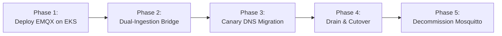

# Migration Guide & Architecture: Mosquitto to EMQX Enterprise Cluster on AWS EKS

- **Status:** Approved Architecture Migration Specification
- **Version:** 1.0.0
- **Scope:** Ingestion Infrastructure Scaling (from 20k to 500k+ Concurrent Devices)
- **Target Audience:** DevOps, SREs, Cloud Engineers, Backend Architects

---

## 1. Executive Summary & Problem Statement

Currently, Sentinel IoT Platform employs a standalone Eclipse Mosquitto instance as its MQTT gateway. While Mosquitto is lightweight and efficient for early stages (< 20,000 devices), it exhibits fundamental limitations for tier-1 industrial production:
1. **Single-Node Bottleneck:** Mosquitto is a single-process C application without native distributed clustering. Horizontal scaling is not possible without custom multi-broker bridges.
2. **JVM Ingestion Overhead:** Inbound telemetry must traverse Spring Boot's `MqttConsumerService` adapter before reaching Kafka, consuming JVM heap and CPU for simple protocol bridging.
3. **High Availability Limitations:** In-cluster Mosquitto pod failure requires Kubernetes pod restart (~15–30s downtime), during which field devices disconnect and buffer offline.

**Target State:** Migrate to an **EMQX 5.x Cluster on AWS EKS** using the EMQX Kubernetes Operator and Mria architecture, unlocking:
- 100,000 to 1,000,000+ concurrent persistent connections.
- Native multi-node clustering with automatic session replication.
- Direct Rule Engine Kafka data bridge (bypassing the JVM ingress proxy).
- 99.99% broker availability with rolling updates and zero connection dropouts.

---

## 2. Technical Comparison Matrix

| Architectural Aspect | Eclipse Mosquitto 2.x | EMQX 5.x Cluster |
|---|---|---|
| **Runtime Architecture** | Single-threaded C event loop | Distributed Erlang/OTP BEAM VM |
| **Clustering Model** | None (Single node / manual bridge) | Native Mria Architecture (Core + Replicant nodes) |
| **Connection Ceiling** | ~20,000 - 50,000 | 1,000,000+ per cluster |
| **High Availability** | Active-Passive / Pod restart recovery | Active-Active Multi-AZ (Zero downtime failover) |
| **Kafka Integration** | Requires external app bridge (Spring Boot) | Built-in high-performance native Kafka Data Bridge |
| **TLS Offloading** | Software TLS inside container | AWS NLB TLS Offload or In-cluster TLS termination |
| **Monitoring** | Basic `$SYS` topics + external exporter | Native Prometheus metrics endpoint, Dashboard UI, OTLP |
| **Rule Engine** | None | Built-in SQL stream processing (`SELECT ... FROM ...`) |

---

## 3. Target EMQX Architecture on AWS EKS

```mermaid
flowchart TB
    subgraph Edge Devices [Industrial Edge Tier]
        D1[Sensors / Gateways]
        D2[Factory PLC Units]
    end

    subgraph AWS [AWS Cloud - EKS Cluster]
        NLB[AWS Network Load Balancer<br/>Multi-AZ / TLS Terminated / PROXY Protocol v2]

        subgraph EMQX [EMQX 5.x Cluster - Mria Topology]
            subgraph Replicants [Stateless Replicant Nodes - Deployment with HPA]
                R1[Replicant Pod 1]
                R2[Replicant Pod 2]
                R3[Replicant Pod 3]
            end

            subgraph Cores [Stateful Core Nodes - StatefulSet]
                C1[Core Pod 1<br/>Raft Consensus]
                C2[Core Pod 2<br/>Raft Consensus]
                C3[Core Pod 3<br/>Raft Consensus]
            end
        end

        subgraph Sinks [Data Sinks & Backend]
            Kafka[Kafka Cluster<br/>telemetry.raw]
            Backend[Spring Boot Backend Tier<br/>API + Analytics + WebSocket]
            Postgres[(PostgreSQL 16 Multi-AZ)]
        end
    end

    D1 & D2 -->|TLS Port 8883| NLB
    NLB -->|Load Balanced TCP| R1 & R2 & R3
    R1 & R2 & R3 <-->|Internal RPC| C1 & C2 & C3
    
    R1 & R2 & R3 -->|EMQX Native Rule Engine<br/>Direct Kafka Sink (Bypasses Spring Boot)| Kafka
    Kafka -->|Batch Ingest Consumer| Backend
    Backend -->|Persist| Postgres
```

### 3.1 Mria Architecture Explained
- **Core Nodes (StatefulSet, 3 replicas):** Act as the database layer for the cluster (using Mnesia/Raft consensus). They maintain client metadata, ACL policies, route tables, and cluster schemas. Devices rarely connect directly to Core nodes.
- **Replicant Nodes (Deployment, 3–10 replicas with HPA):** Purely stateless worker nodes that terminate device TCP/TLS connections and forward MQTT messages. They scale out dynamically based on connection count or CPU utilization without participating in Raft consensus.

---

## 4. EMQX Native Rule Engine & Kafka Data Bridge

By utilizing EMQX's built-in Data Bridge, we eliminate the Spring Boot `MqttConsumerService` ingestion bottleneck entirely. EMQX streams messages straight to Kafka `telemetry.raw` at wire speed.

### 4.1 EMQX SQL Rule Configuration
```sql
SELECT
  clientid as device_id,
  topic as mqtt_topic,
  payload as raw_payload,
  timestamp as ingest_timestamp
FROM
  "tenants/+/telemetry", "tenants/+/devices/+/telemetry"
WHERE
  payload != null
```

### 4.2 Kafka Sink Resource Configuration
```hocon
bridges {
  kafka {
    telemetry_bridge {
      bootstrap_hosts = "sentinel-kafka:9092"
      topic = "telemetry.raw"
      compression = "lz4"
      max_batch_bytes = 1048576
      required_acks = "all"
      buffer {
        mode = "memory"
        per_partition_limit = 512MB
      }
    }
  }
}
```

---

## 5. Zero-Downtime Migration Execution Plan

The migration follows a phased **Blue/Green Dual-Bridge Cutover** strategy to guarantee that no telemetry is dropped and field devices experience zero outage.



### Phase 1: Infrastructure Deployment (Week 1)
1. Install EMQX Operator in EKS:
   ```bash
   helm repo add emqx https://repos.emqx.io/charts
   helm repo update
   helm install emqx-operator emqx/emqx-operator --namespace emqx-operator --create-namespace
   ```
2. Provision EMQX CRD (`apps.emqx.io/v2beta1`) with 3 Core nodes and 3 Replicant nodes.
3. Configure AWS NLB with TLS termination on port 8883 and PROXY protocol enabled.
4. Set up EMQX Kafka Data Bridge pointing to `telemetry.raw`.

### Phase 2: Dual Ingestion & Verification (Week 2)
1. Configure an MQTT bridge in Mosquitto forwarding 100% of telemetry to the new EMQX cluster.
2. Verify Kafka message parity and latency in Prometheus:
   - Ensure message timestamps, tenant extraction, and schemas match perfectly.
   - Run end-to-end chaos tests against EMQX pods.

### Phase 3: Canary Device Migration (Week 3)
1. Update DNS records on AWS Route 53:
   - Old: `mqtt.sentinel.example.com` (Mosquitto NLB)
   - New: `mqtt-v2.sentinel.example.com` (EMQX NLB)
2. Use Weighted DNS routing:
   - **Day 1:** 5% traffic to EMQX, 95% to Mosquitto.
   - **Day 3:** 25% traffic to EMQX.
   - **Day 5:** 50% traffic to EMQX.
3. Monitor Kafka partition balance and JVM consumer lag.

### Phase 4: Full Cutover & Connection Drain (Week 4)
1. Set Weighted DNS to 100% EMQX.
2. Send remote MQTT reconnect broadcast to remaining legacy devices on Mosquitto with `backoff_jitter` to prevent a thundering herd.
3. Verify connection count on Mosquitto drops to zero.

### Phase 5: Decommissioning (Week 5)
1. Terminate Mosquitto deployment and release legacy load balancers.
2. Disable legacy `MqttConsumerService` listener in Spring Boot to reclaim JVM resources.

---

## 6. Capacity Planning & Sizing Guide

### Sizing for 100,000 Industrial Devices (Publishing every 5 seconds)

| Resource Metric | Specification / Calculation | Notes |
|---|---|---|
| **Concurrent Connections** | 100,000 persistent TCP sessions | Keep-alive: 60s |
| **Ingestion Message Rate** | 20,000 msgs/sec | Avg payload: 512 bytes |
| **Total Ingestion Bandwidth**| $\approx 10.24\text{ MB/s}$ (82 Mbps) | Easily handled by AWS NLB |
| **EMQX Core Nodes** | 3 nodes $\times$ (2 vCPU, 4 GB RAM) | m6i.large or equivalent |
| **EMQX Replicant Nodes** | 3 nodes $\times$ (4 vCPU, 8 GB RAM) | c6i.xlarge (auto-scale up to 6 nodes) |
| **Linux Kernel Optimization** | `sysctl -w fs.file-max=2097152`<br/>`sysctl -w net.ipv4.ip_local_port_range="1024 65535"` | Configured via daemonset or node init |

---

## 7. Tradeoff Analysis & Architecture Alternatives

| Evaluation Dimension | EMQX 5.x Cluster on EKS (Chosen) | AWS IoT Core (Managed Cloud) | Retain Mosquitto + Horizontal Bridges |
|---|---|---|---|
| **Monthly Cost at Scale (100k devices @ 1 msg/s)** | **~21,000 - 28,000 บาท / เดือน** (Fixed EC2 compute on EKS). | **~907,200 บาท / เดือน** (คิดตามอัตรา 35 บาทต่อ 1 ล้าน 5KB meters: 25.9 พันล้าน msgs/เดือน). | **~7,000 บาท / เดือน**, but will crash/drop packets above 20k conns. |
| **Kafka Integration** | **Native C/Rust Data Bridge**. Zero app intermediary. | Requires AWS Kinesis / Lambda bridge to stream to Kafka. | Requires Spring Boot JVM bridge (bottleneck at >20k msgs/s). |
| **Cloud Portability & Lock-In** | **Zero Lock-In**. 100% portable to EKS, GKE, AKS, or Bare-Metal. | **Severe Lock-In**. Deeply coupled to AWS IAM, rules, and APIs. | Zero Lock-In. |
| **Operational Maintenance** | Moderate. Requires managing EMQX Operator & Helm releases. | **Zero Maintenance**. Fully managed serverless broker by AWS. | High if manually bridging multiple Mosquitto nodes. |
| **Connection Capacity** | **1,000,000+** concurrent connections (Mria topology). | Millions (serverless quota expansion upon request). | ~20,000 per node (Single-process C limit). |
| **Multi-Tenancy ACLs** | Built-in authentication & topic authorization via PostgreSQL/Redis. | AWS IoT Policies (complex JSON IAM-like documents). | Flat password file or custom plugin. |

### Decision Rationale:
- **AWS IoT Core** was rejected primarily due to **exponential messaging costs at industrial frequency**. An industrial IoT fleet generating 20,000 to 100,000 messages per second costs over 875,000 บาท/เดือน on AWS IoT Core purely in messaging meter fees, compared to less than 28,000 บาท/เดือน on dedicated EKS EC2 instances. Additionally, AWS IoT Core lacks a native Kafka producer, requiring a complex chain of AWS IoT Rules $\rightarrow$ Kinesis Data Streams $\rightarrow$ Kafka Connector.
- **Retaining Mosquitto with Horizontal Bridges** was rejected because manual broker bridging introduces high message routing latency, message duplication risks, and lacks a centralized session state table.
- **EMQX Cluster on EKS** was chosen because it delivers carrier-grade Erlang/OTP connection scalability, predictable fixed compute costs, zero cloud vendor lock-in, and direct wire-speed streaming into Apache Kafka via its native Rule Engine.

**Tradeoff Accepted:** Operational responsibility for maintaining the EMQX Kubernetes Operator, tuning Linux OS kernel file descriptors (`fs.file-max`, `somaxconn`), and monitoring Erlang BEAM virtual machine memory on EKS.
